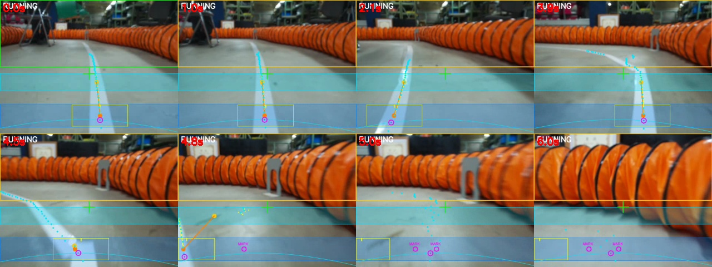

# ピュアパシュートのコースアウト調査（2026-11-18）

## まとめ

- 2026-11-18 のピュアパシュート（`LINE_ALGO=pp`）の走行で、毎回左右にふらついたあと、左カーブでラインを見失ってコースアウトした。
- 原因は車ではなくプログラム。車は十分に遅く、カーブもゆるい。
  1. **先読み距離が短すぎた。** 0.45m の目標点がいつも画面の一番下に張り付き、奥のカーブを使わずに反応が遅れた。
  2. **ラインを見失った後の扱い。** ピュアパシュートが床の白い点々などをラインと間違え、ハンドルを戻して直進した。
- 対策は3つ。
  - 先読み距離を 0.65m に上げる。
  - ラインが画面の端に寄ったら、今の方式で大きく切る。
  - ラインを見失ったら、最後のハンドルを保持する。
  - あわせて、見失った後にノイズの点をつないで追い続けないようにした。

## 調べた走行

| 項目 | 値 |
|---|---|
| 走行記録 | `logs/run_20261118_111730`（csv・_settei.json・mp4） |
| 方式 | `LINE_ALGO=pp`、`PP_LD_KIHON=0.45`、`KIREKAKU_DO=25`、`WHEELBASE=0.257`、`ACCEL_SAIDAI=0.3` |
| ライン | 白線（`LINE_IRO=shiro`） |
| キャリブレーション | 済み。画面の一番下 ＝ 後輪の車軸から **0.40m** 先 |
| 結果 | 4.96 秒でラインを見失い、そのまま直進してコース脇のダクトに接触 |

同じ日の pp の走行（`run_20261118_110744`、`run_20261118_111556`）も、2〜2.5 秒で同じように左へ大きく振られていた（横ズレ -223px、-317px）。

### log_kaiseki.py の判定について

`tools/log_kaiseki.py` は「ハンドルが左右いっぱいのまま曲がりきれていない → 原因は車の側（最小回転半径・切れ幅・速すぎ）」と判定した。
しかし左右いっぱいに切ったのは、ラインが画面から外れかけた最後の 0.3 秒だけだった。切り始めが遅かったのが原因で、車が曲がれなかったのではない。この判定は今回は外れている。

## 何が起きたか

| 時刻 | 様子 | ハンドル |
|---|---|---|
| 0〜3.5 秒 | 直線で左右にふらつく。横ズレが +40 → -185 → +75px と振れる | -0.65〜+0.31 |
| 3.9 秒 | 画面の奥に左カーブがはっきり映っている。目標点は画面の一番下のまま | +0.31（右） |
| 4.5 秒 | ラインが画面の左下へ抜け始める | -0.04（ほぼまっすぐ） |
| 4.6〜4.9 秒 | ここで初めて左に大きく切る | -0.22 → -0.95 |
| 4.96 秒 | 近くの帯からラインが消える | |
| 5.0 秒〜 | 今の方式は -1.00（左いっぱい）を保持。ピュアパシュートは点群（20〜30 点）をノイズの上に作り、ハンドルを戻した | -0.2〜+0.1 |
| 6.0 秒 | ダクトに向かって直進している | |

「ラインが近くの帯に無かったコマ 107/262（41%）」は、ほぼすべてこのコースアウト後のコマ。

## 原因

### 1. 先読み距離が、カメラに映る一番手前とほぼ同じだった

キャリブレーションから計算した、画面の高さと床の上の距離の対応は次のとおり。

| 画面の高さ | 後輪の車軸から | 100px あたりの横幅 |
|---|---|---|
| 0.95（一番下の近く） | 0.42m | 6.0cm |
| 0.865（近くの帯の中央） | 0.47m | 6.8cm |
| 0.68（遠くの帯の下） | 0.62m | 9.4cm |
| 0.55（遠くの帯の上） | 0.83m | 13.0cm |

- `PP_LD_KIHON=0.45` だと、目標点は画面の一番下（記録では前方 0.43〜0.45m）に来る。奥に映っているカーブは使われず、実質「足元のズレ」だけで切っていた。
- 先読み距離がホイールベース（0.257m）の 1.75 倍しかない。処理の遅れもあり、ふらつきやすい設定だった。
- 画面の一番下は左右に約 ±19cm しか映らない。少しふらつくだけでラインが横から外れる。
- `docs/LINETRACE_EVAL.md` のシミュレーションでは 0.45 が良かった。ただしシミュレーションのカメラは 0.28m 先から見えていて、実車（0.40m）より近くまで映っていた。

### 2. ラインを見失った後、ピュアパシュートがノイズを追い続けた

- `line_algo.PurePursuit.keisan()` は、近くの帯にラインが無いコマでは、前のコマで見つけた点を探し始めの位置に使う。
- そこから点が見つかると、その点を次のコマの予備としてまた保存していた。このため予備を予備でつなぎ、床の白い点々やマークを「ライン」としてどこまでも追えてしまった。
- `rc_race.py` は、ピュアパシュートの目標点が決まっていれば、近くの帯にラインが無くてもそのハンドルを使っていた。見失いの判定にも数えていなかった。
- 結果として、今の方式なら左いっぱいを保持するところで、ハンドルがほぼまっすぐに戻った。
- さらに、近くの帯にまだラインがある最後の数コマ（ラインが画面の端、横ズレ -316px）でも、点群はノイズに飛び移っていた。そのコマのハンドルは -0.17 だった。

## 対策（feature/pure-pursuit）

| ファイル | 変更 |
|---|---|
| `rc_race.py` | `PP_LD_KIHON` の初期値を 0.45 → **0.65**。「画面の一番下より 0.2m 以上遠くにする」と説明を追加 |
| `line_algo.py` | `SHOKICHI` の `PP_LD_KIHON` を 0.65 に（rc_race.py と同じ値） |
| `kuruma_settei_sample.json` | `PP_LD_KIHON` を 0.65 に。説明も同じく追加 |
| `rc_race.py` `nou_de_handan()` | 近くの帯にラインが無いコマと、ラインが画面の端（中央から端までの `PP_HASHI`=0.75 より外、640px 画像で ±240px 超）のコマでは、ピュアパシュートを使わず今の方式で切る。端では大きく切り、見失ったら最後の値を保持する |
| `rc_race.py` 見失いの判定 | 「ピュアパシュートで走っている間は見失いとしない」をやめ、今の方式と同じ `line_mieru` だけで判定する |
| `rc_race.py` 走行記録 | `_settei.json` に `PP_HASHI` を記録する |
| `line_algo.py` `PurePursuit.keisan()` | 予備の位置から見つけた点は、次のコマの予備にしない。予備が使えるのは、最後にラインが見えたコマから 10 コマまで |

各車の `kuruma_settei.json` に `PP_LD_KIHON` が保存されていると、そちらが優先される。ラズパイの `kuruma_settei.json` も 0.65 に直す必要がある（pp_test の画面のスライダーで変えるか、ファイルの値を直す）。

## 確かめたこと

### 記録した映像での再生（実車では未確認）

`run_20261118_111730.mp4` の各コマを、新しい `line_algo.py` に通してハンドルを計算した。映像は 480×360 に縮小され、画面表示が描き込まれている。

- 先読み 0.45m で計算すると、記録されたハンドルとほぼ同じ値になった。再生のやり方そのものは妥当。
- 先読み 0.65m：
  - 直線でのハンドルの振れが約半分になった（例: 1.63 秒 -0.40 → -0.20）。
  - 左カーブへの切り始めが約 0.1 秒早くなった（4.40 秒で 0.45m は +0.02、0.65m は -0.08）。
- 新しい切り替えの規則では、4.73 秒（横ズレ -252px）から今の方式の -1.00 に切り替わる。ラインを見失った後も -1.00 を保持した（変更前は -0.2〜+0.1 に戻っていた）。
- **注意:** これは同じ映像に対する計算で、ハンドルを変えたら車の通り道も変わる。実際に曲がりきれるかは、実車で走らせて確かめる必要がある。

### 合成画像の試験（`tools/linetrace_sim/gazou_test.py`）

- 長円（半径 1.5m）を 1.0・1.5 m/s で、pd・pp ともに 2/2 周できた。
- ただしこの試験は `kuruma_settei.json` の `PP_LD_KIHON` を 0.45 にしても 0.65 にしても同じ結果だった。先読み距離の変更は、この試験では確かめられていない。

## 次に確かめること

1. ラズパイの `kuruma_settei.json` の `PP_LD_KIHON` を 0.65 にして、同じコースを走る。
2. log_kaiseki.py で次の3点を見る。
   - 直線での横ズレの振れ（0.45m のときは ±185px）
   - 左カーブでラインを見失わずに抜けられたか
   - 「ラインが近くの帯に無かったコマ」の割合
3. カーブの内側を通りすぎる（インカット）ようなら 0.55〜0.60m を試す。まだふらつくなら 0.70〜0.75m を試す。
4. `log_kaiseki.py` の「左右いっぱい → 車の側が原因」という判定は、切り始めが遅い場合と区別できない。見直すとよい。
