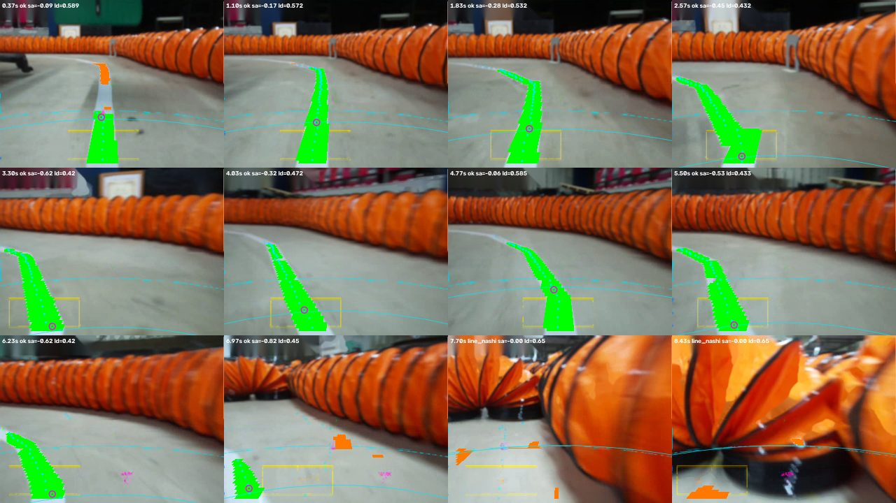

# ライン検出の仕様変更（2026-11-19）

## 変更の目的

2026-11-19 の走行（`run_20261119_115100`）で、ライン検出に次の問題が見つかった。

- カーブでラインが画面の左下へ抜けたあと、ピュアパシュートが **画面中央の点々**（床と筒の境目・反射）を「ライン」と間違えて追い、まっすぐ筒へ向かった。
- 横線（MARK）を床の白い部分と見間違える。白線のコースでは誤検出が多く、横線で止まる仕組みも要らない。
- 近くの帯・遠くの帯という画面の決め打ちが、ラインが斜めや上へ伸びる形に合わない。

## 変更の内容

| 項目 | 変更前 | 変更後 |
|---|---|---|
| ラインの探し方 | 画面の近くの帯・遠くの帯を見て、そこから点群を作る | 映像を**真上から見た図**に直し、**足元とつながった塊**だけをラインにする |
| 誤認の抑え方 | しきい値（明るさ）だけ | 明るさ ＋ **周りの床との差** ＋ **ライン幅（30〜50mm）** ＋ **足元につながっていること** |
| 先読み距離 | 固定（0.65m） | **カーブがきついほど短く**（PP_LD_CURVE） |
| ラインが見えないコマ | 今の方式（PD）に戻る | **最後のハンドルを保持**（床のノイズに飛びつかない） |
| 今の方式（PD）との切り替え | コマごとに自動 | `LINE_ALGO="pd"` のときだけ使う（`"pp"` では使わない） |
| 横線（MARK）で止まる | あり | **なし**（`GOAL_KENCHI=False`。True に戻せる） |

止まるのは、STOP ボタン・ラインロスト・時間切れ・通信断のときだけになる。

### 足元からたどる検出の流れ（`line_algo.py` の `Kenshutsu`）

1. 映像を、床の上の寸法（1画素＝約6.7mm）の「真上から見た図」に直す。
2. 周りの床より明るい（黒線なら暗い）所だけを残す。床の広い明るいムラや蛍光灯の反射は、周りとの差が出ないので消える。
3. 幅が `PP_HABA_MIN`〜`PP_HABA_MAX`（初期値 20〜75mm）の細長いものだけを残す。細かいゴミと、太い塊（反射など）を消す。
4. つながった塊ごとに分け、車の足元（前のコマのラインの位置の左右 `PP_GATE_Y`）に届いている塊を**1つだけ**ラインとして選ぶ。つながっていない明るい所は候補にならない。
5. 選んだ塊の中だけを、同心円で奥へたどって点の列にする。そこからピュアパシュートの式でハンドルを決める。

### 先読み距離の縮め方

先読み距離 ＝ `PP_LD_KIHON` ÷ (1 ＋ `PP_LD_CURVE` × カーブのきつさ[1/m])。ただし、画面に映る一番手前より近くは見えないので、そこより縮めない。

### ラインが横へ抜けたとき

大きく切っている最中（ハンドルの大きさ 0.7 以上）にラインが画面の横へ抜けたときは、そのまま切り続けるとラインが戻ってくる。そのため、止めるまでの待ちを 10コマから 20コマ（約0.67秒）に延ばす（`ROSUTO_KAKUTEI_KIRI`、`ROSUTO_KIRI_HANTEI`）。

## 設定（調整できる値）

| 名前 | 初期値 | 保存先 | 意味 |
|---|---|---|---|
| `SHIRO_SHIKII` / `KURO_SHIKII` | （今までどおり） | kyotsu_settei.json | 明るさのしきい値 |
| `PP_SA` | 30 | kyotsu_settei.json | 周りの床との明るさの差の下限 |
| `PP_HABA_MIN` / `PP_HABA_MAX` | 0.020 / 0.075 [m] | kyotsu_settei.json | ライン幅の下限・上限。ラインの太さを変えたら合わせる |
| `PP_GATE_Y` | 0.30 [m] | kuruma_settei.json | 前のコマの位置から左右に探す範囲 |
| `PP_LD_CURVE` | 0.6 | kuruma_settei.json | カーブで先読み距離を縮める強さ |
| `GOAL_KENCHI` | False | どちらでも | 横線で止まる仕組みのON/OFF |

調整は `pp_test.py` の画面のスライダーでできる（モーターは動かない）。上から3つ（しきい値・明るさの差・ライン幅）は「値を保存する」で共通設定へ、残りは車ごとの設定へ保存される。「白黒で見る」を押すと、検出の結果が見える。

- **白** ＝ラインとして選んだ塊
- **灰色** ＝ラインらしいが、選ばれなかった所
- **黒** ＝それ以外

床の反射が灰色や白で出るときは、`PP_SA` を上げるか、しきい値を上げる。ラインが途切れるときは、下げる。

走行記録（csv）には、最後に `PP状態` の列が増える（`ok` ／ `line_nashi`＝足元にラインが無い ／ `ten_sukunai`＝足元に少し見えるだけ）。

## 確かめたこと

### 1. 記録した実走行の映像（`run_20261119_115100`）で、誤認が出ないか

- 緑がラインとして選んだ塊。直線からカーブまで、ラインだけが選ばれている。
- 6.97 秒（ラインが画面の左下の隅に出かかったコマ）でも、ラインを追えている。
- 7.70 秒以降（ラインが画面から消えたコマ）は `line_nashi` になり、床と筒の境目を追わない。**前回の逸脱の原因（ノイズ追従）は、この映像では再現しなかった。**
- 切り始めは、記録されたハンドルよりも早く大きくなった（例: 3.0 秒で -0.54 → -0.77）。

**この確認の限界**
- 映像は 480×360 に縮小され、帯の色づけや枠線が描き込まれている。帯の色づけと枠は逆算して取り除いたが、完全には戻らない。
- ラズパイのキャリブレーション値（kuruma_settei.json）は手元に無かったので、`PP_COURSEOUT_20261118.md` の距離の表から作った近似の変換を使った。実機のキャリブレーションとは少し違う。
- ハンドルを変えれば車の通り道も変わるので、**曲がりきれるかは、実車で走らせて確かめるしかない。**

### 2. 合成画像で周回する試験（`tools/linetrace_sim/gazou_test.py`、新しい検出）

| コース | 1.0 m/s | 2.0 m/s | 3.0 m/s |
|---|---|---|---|
| 長円（半径1.5m） | 2/2 周 | 2/2 周 | 2/2 周 |
| 長円＋蛇行ライン | 2/2 周 | 2/2 周 | 2/2 周 |
| テクニカル | 2/2 周 | 2/2 周 | 2/2 周 |
| きつい角（半径0.35m） | 0/2（見失い） | 2/2 周 | 0/2（コースアウト） |

- 1コマの計算時間は約3ms（この試験を動かしたパソコンでの値。ラズパイでは数倍かかる見込み）。
- 「きつい角」（半径0.35mの四角いコース）は、速度によって周回できたりできなかったりで安定しない。今の方式（PD）は全速度で周回できず、前の版のピュアパシュートは 1.0 m/s のみ周回できた。極端なコースなので、実際のコースでは問題にならない可能性が高いが、**この試験では前の版より良いとは言えない。**
- 試験の画像には、床の反射のような誤認の元が入っていない。誤認への強さは、この試験では確かめられていない。

### 3. 画面（pp_test.py）

新しいスライダー（明るさの差・ライン幅・探す範囲・カーブで縮める強さ）が表示され、保存まで動くことを、疑似カメラで確かめた。

## 実車で確かめること

1. `pp_test.py` で、ラインの上を見る（モーターは動かない）。「白黒で見る」で、ラインが白、床や反射が黒になるか。蛍光灯の近くや、床の明るい所を通して見る。
2. 白線の幅が 30〜50mm なら、`PP_HABA_MIN`・`PP_HABA_MAX` は初期値のままでよい。
3. 走らせたあと、`log_kaiseki.py` と映像で次を見る。
   - ハンドルが左右いっぱいに張り付いたか（前回は張り付かなかった）。
   - `PP状態` が `line_nashi` になったコマが、いつ・どれだけ続いたか。
   - カーブでラインを見失わずに抜けられたか。
4. カーブで内側を通りすぎる（インカット）なら `PP_LD_CURVE` を下げる。外へふくらむなら上げる。

## 変えたファイル

- `line_algo.py`：`Kenshutsu`（足元からたどる検出）、`TengunTori`、`PurePursuit.keisan_gazou()`、新しい設定の初期値
- `rc_race.py`：設定の追加、ピュアパシュート1本での走行、`GOAL_KENCHI`、見失い時の保持と待ち、画面（帯の表示は今の方式のときだけ）、記録（`PP状態`）
- `pp_test.py`：新しいスライダー、検出の切り替え、白黒表示、保存先の振り分け
- `tools/linetrace_sim/gazou_test.py`：新しい検出で周回試験を行うように変更
